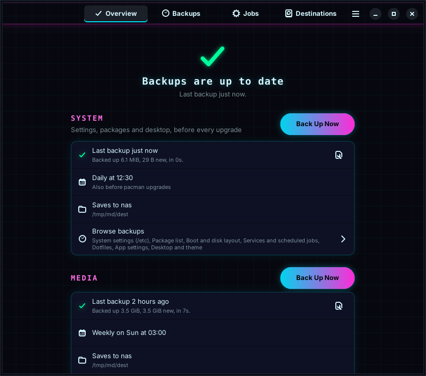
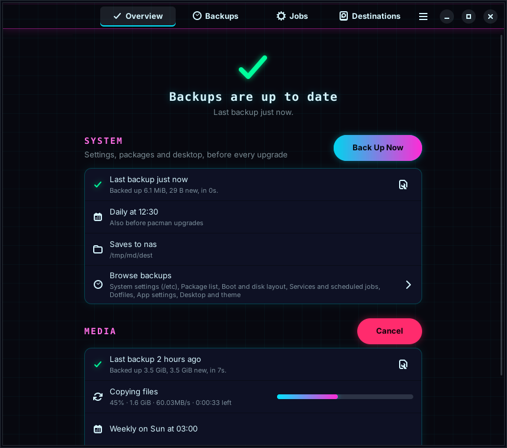
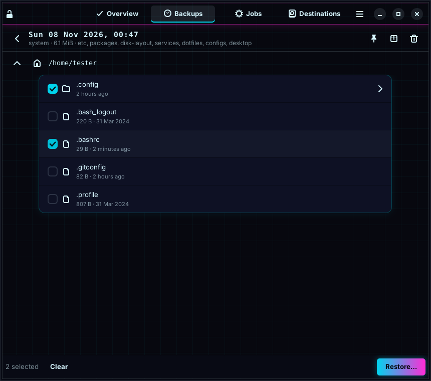
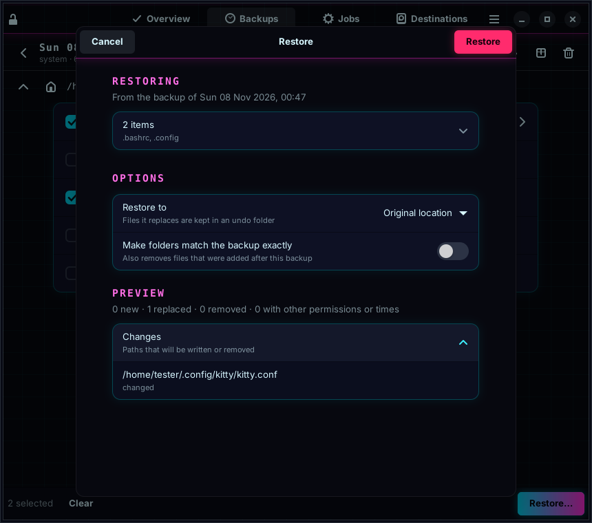

# Mikoshi

Snapshot backups for Arch Linux, built on rsync. A GTK app with a neon cyberpunk look for
everyday use, and a full command line for SSH and scripts.

*Named after the vault where saved minds are kept: Mikoshi keeps saved copies of your system.*

Mikoshi backs up the parts of your system you pick, on a schedule, before pacman upgrades,
or when you plug in a drive. Every backup is a **normal folder** you can open in a file
manager. Files that didn't change are shared between backups (hard links), so keeping many
costs little space.

| | |
|---|---|
|  |  |
|  |  |

## What it can back up

| Module | What's in it |
|---|---|
| **System settings** (`etc`) | Everything in `/etc` |
| **Package list** (`packages`) | Official and AUR package lists, plus a `reinstall.sh` script |
| **Boot and disk layout** (`disk-layout`) | Partition tables, UUIDs, mounts, `/boot`, LVM and btrfs layout, LUKS headers (encrypted destinations only) |
| **Services** (`services`) | Enabled services, systemd overrides, crontabs, plus a re-enable script |
| **Dotfiles** (`dotfiles`) | `.bashrc`, `.zshrc`, `.gitconfig`, `.vim` and friends |
| **App settings** (`configs`) | `~/.config` (without app caches) |
| **Desktop and theme** (`desktop`) | KDE, GNOME (plus a `dconf` dump), Xfce, Cinnamon, Hyprland, Sway and more; themes, icons, fonts, wallpapers |
| **Home folders** (`home`) | Everything in `/home`, minus caches, trash, Steam games and toolchains |
| **Browser profiles** (`browsers`) | Firefox, Chromium-based browsers and forks (without caches) |
| **Keys and passwords** (`secrets`) | `~/.ssh`, `~/.gnupg`, keyrings, pass. Encrypted destinations only |
| **Full system** (`system`) | Every local filesystem that makes up the system |

Plus any extra folders you add, and rsync exclude patterns.

## Where backups can go

- **A folder** on a drive that's always mounted.
- **A drive** found by UUID, such as a USB drive. Mikoshi mounts it, unlocks it if it's LUKS
  and you gave a key file, and unmounts it afterwards. If it isn't plugged in, the run is
  skipped, not failed.
- **An NFS share.** Mikoshi mounts it itself with short timeouts, so a NAS that's down makes
  the job fail instead of freezing your PC.

Mikoshi tests each destination before using it: hard links (FAT and exFAT are refused),
whether it can keep file owners, and whether it's on the same disk as your system.

## Install

From the AUR (once published):

```
paru -S mikoshi mikoshi-gui
```

Latest development version straight from GitHub:

```
git clone https://github.com/NullWRX/Mikoshi
cd mikoshi/packaging/mikoshi-git
makepkg -si
```

`mikoshi` is the command line tool, timers and pacman hook (fine on a headless box).
`mikoshi-gui` adds the app.

## Quick start

**App:** open Mikoshi, choose **Set Up a Backup**, add a destination, pick what to back up
and when, then **Back Up Now**.

**Command line:**

```
mikoshi drives                  # find your backup drive's UUID
sudo mikoshi config edit        # starts from a commented example
sudo mikoshi check usb          # test the destination
sudo mikoshi run daily          # first backup, with progress
mikoshi status
```

Restore a file or folder (a preview is shown first, and replaced files are kept in
`/var/lib/mikoshi/undo/`):

```
sudo mikoshi list daily
sudo mikoshi restore daily 2026-11-07_02-30-00 /home/me/.config/kitty
sudo mikoshi restore --to /tmp/old daily 2026-11-07_02-30-00 /etc
```

See `man mikoshi` and `man mikoshi.conf` for everything else.

## How it works

```
<destination>/mikoshi/<host>/<job>/
    snapshots/
        2026-11-07_02-30-00/
            files/          the backed-up paths, laid out from /
            meta/           package lists, disk layout, service lists
            manifest.json   what was backed up and the result
    latest -> snapshots/2026-11-07_02-30-00
```

- **One rsync per run** with `--link-dest` pointing at the previous snapshot.
- **Interrupted runs resume.** A run writes to `.in-progress/` and is renamed only when it
  succeeds. Cancel it, lose power, or unplug the drive, and the next run picks up where it
  stopped.
- **Retention** works like restic and borg: keep the newest N, then one per hour, day, week,
  month and year. Pinned snapshots and the newest one are never removed. An optional space
  guard removes the oldest snapshots when the destination gets too full.
- **Schedules** are systemd timers with `Persistent=true`, so a backup missed while the PC was
  off runs at the next boot. `mikoshi schedule cron` prints crontab lines if you prefer cron.
- **The app runs as you.** Anything that needs root goes through a small helper started with
  `pkexec`, so you enter your password once per session. Backups and restores run as systemd
  units, so closing the app never interrupts them.

### Reinstalled? Use your existing backups

Each PC keeps its backups in a folder named after it, marked with a fingerprint of the
machine so two computers with the same name never mix their backups. After a reinstall,
choose **Use Existing Backups** on first start (or **Find Backups** on the Destinations tab),
point it at the drive or NAS, and pick the PC. Mikoshi recreates its jobs and continues the
same backups. Imported jobs start turned off so backups of the fresh system can't push out
the old ones before you've restored. Encrypted (LUKS) drives ask for their passphrase.

From the command line: `sudo mikoshi find-backups nas`, then `sudo mikoshi adopt nas <pc>`.

### Restoring without Mikoshi

Backups are plain files. To restore with owners and permissions:

```
sudo rsync -aHAX --numeric-ids <snapshot>/files/./home/me/.config /
```

## Testing

See [docs/TESTING.md](docs/TESTING.md) for a VM test plan.

## Coming from Lifeboat

Mikoshi used to be called Lifeboat. Installing `mikoshi-git` replaces `lifeboat-git` and
carries everything over automatically: config, history, logs, schedules, and the backups at
your destinations (their `lifeboat` folders become `mikoshi` the next time they're used).

## Status

Version 0.1: file-level backups, restores, scheduling, triggers, pruning and the app are done
and tested. Planned next:

- **Bare-metal restore** from a full-system backup (rebuild partitions, restore, reinstall
  the bootloader) from a rescue USB.
- **A custom Arch ISO builder** that bakes in your packages and configs, and doubles as the
  rescue USB.
- **Block-level disk images** (partclone) from the rescue environment.

## License

GPL-3.0-or-later. See [LICENSE](LICENSE).
